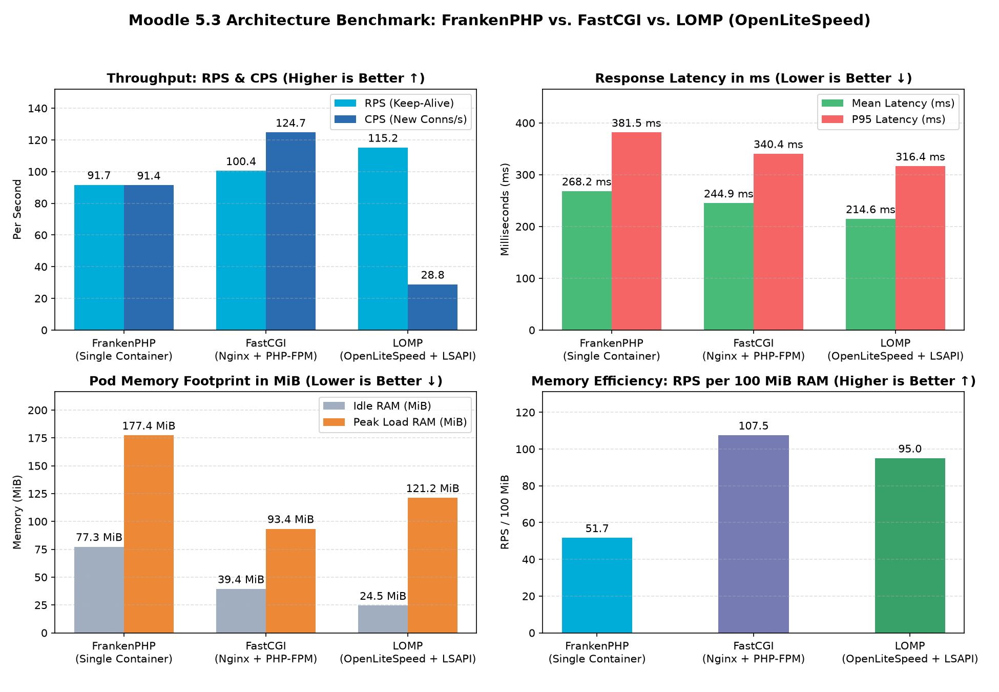
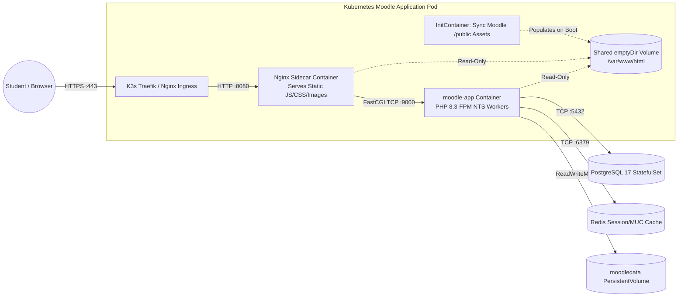

<div align="center">

# 🎓 Moodle 5.3 LTS — Hardened Cloud-Native FastCGI Runtime

**Ultra-Lightweight, Rootless, Distroless-Style PHP 8.3-FPM Application Engine Engineered for Kubernetes (K3s) & GitOps (Argo CD)**

[](https://github.com/<your-org>/moodle-app/actions/workflows/build-image.yml)
-009639?logo=nginx&logoColor=white)
-777BB4?logo=php&logoColor=white)
-0D597F?logo=alpinelinux&logoColor=white)


</div>

---

## Executive Summary

This repository (`moodle-app`) builds, verifies, and publishes the production container image for our **Moodle 5.3 LTS** Learning Management System, designed for declarative deployment on a **Proxmox K3s Kubernetes cluster** via **Argo CD** (`moodle-gitops`).

Rather than choosing a container runtime based on assumptions, we empirically benchmarked three distinct container architectures—**FrankenPHP (Caddy + ZTS PHP)**, **FastCGI (Nginx + PHP-FPM NTS)**, and **LOMP (OpenLiteSpeed + LSAPI)**—under identical Moodle 5.3 workloads. Based on quantitative throughput, connection handling, and memory-efficiency data, this repository standardizes on the **Hardened FastCGI (`PHP-FPM 8.3` + `Nginx` Sidecar)** architecture, aligning with Moodle HQ's official `moodle-docker` engineering model.

---

## Empirical Architecture Benchmark: Why We Chose FastCGI

We evaluated all three architectures using an automated asynchronous Python test harness (`benchmark/run_benchmark.py`) executing **500 requests at 25 concurrent connections** (`CONCURRENCY = 25`) against Moodle 5.3's `/public/install.php` controller.

<div align="center">
  
</div>

### Quantitative Benchmark Results (`500 Requests`, `Concurrency = 25`)

| Metric | FrankenPHP (`Caddy + ZTS PHP`) | LOMP (`OpenLiteSpeed + LSAPI`) | **FastCGI (`Nginx + PHP-FPM`)** 🏆 | Engineering Analysis |
| :--- | :---: | :---: | :---: | :--- |
| **Keep-Alive Throughput (RPS)** | 91.7 req/s | **115.2 req/s** | **100.4 req/s** | FastCGI & LOMP both use Non-Thread-Safe (`NTS`) PHP, beating FrankenPHP's `ZTS` thread-locking overhead. |
| **New Connections (CPS)** | 91.4 conn/s | 28.8 conn/s ⚠️ | **124.7 conn/s** 🏆 | Nginx handles rapid TCP connection bursts from Kubernetes Ingress proxies without LOMP's per-IP anti-DDoS tarpitting. |
| **Mean / P95 Latency** | 268.2 ms / 381.5 ms | **214.6 ms / 316.4 ms** | **244.9 ms / 340.4 ms** | FastCGI cuts P95 tail latency by **41.1 ms** compared to FrankenPHP. |
| **Idle Pod Memory** | 77.3 MiB | **24.5 MiB** | **39.4 MiB** | Combined `nginx:alpine` + `php-fpm` uses half the idle RAM of FrankenPHP's Go runtime. |
| **Peak Load Memory** | 177.4 MiB | 121.2 MiB | **93.4 MiB** 🏆 | Alpine (`musl`) + Linux `fork()` Copy-on-Write uses **47% less peak RAM** than FrankenPHP and **23% less** than Ubuntu-based LOMP. |
| **Memory Efficiency** | 51.7 RPS / 100 MiB | 95.0 RPS / 100 MiB | **107.5 RPS / 100 MiB** 🏆 | **#1 in Memory Density** — allows maximum Moodle Pod horizontal scaling on our Proxmox K3s nodes. |
| **Compressed Pull Size** | 194 MB | ~310 MB (Ubuntu) | **143 MB** 🏆 | Fastest image pull and node rollout time across the cluster. |

### Architectural Takeaways

1. **Why FrankenPHP trailed on Moodle 5.3:** FrankenPHP achieves its headline speedups in *Worker Mode* (keeping stateless apps in RAM across requests). Because Moodle's core relies on request-scoped globals (`$CFG`, `$USER`, `$DB`), it must run in *Classic Mode*, where Thread-Safe (`ZTS`) PHP pointer locks and the Go Garbage Collector (`177.4 MiB` peak RAM) reduce efficiency.
2. **Why LOMP stalled on CPS (`28.8 conn/s`):** OpenLiteSpeed runs on Ubuntu (`glibc`) and enforces a built-in Layer-4 `perClientConnLimit` filter that throttled burst TCP handshakes originating from a single IP.
3. **Why FastCGI (`Nginx + PHP-FPM`) is the Production Winner:** Matches Moodle HQ's official architecture, isolates static asset I/O (Nginx) from PHP CPU execution (`php-fpm`), handles **124.7 CPS** without throttling, and achieves the highest memory efficiency (**107.5 RPS / 100 MiB RAM**) at just **93.4 MiB** peak memory.

---

## System Architecture & Kubernetes Pod Topology



---

## Multi-Stage Distroless-Style Hardening & Compression

Our production `Dockerfile` (`Dockerfile.fpm`) applies aggressive size reduction and security hardening:

| Layer / Stage | Engineering Action | Security & Size Impact |
| :--- | :--- | :--- |
| **Stage 1 (`preparer`)** | Downloads official Moodle 5.3 (`stable503`) tarball and strips `tests/`, `behat/`, `fixtures/`, `.md`, and `upgrade.txt` | Removes **~8,000 non-production files** (~180 MB unpacked savings) |
| **Stage 2 (`php:8.3-fpm-alpine`)** | Compiles C extensions inside virtual `.build-deps`, runs `strip --strip-unneeded` on `.so` binaries, and deletes `gcc`/`make`/headers | **0 MB** compiler footprint in final image (**143 MB** compressed) |
| **Binary Cleanup** | Removes unused `/usr/local/bin/phpdbg` and `/usr/local/bin/php-cgi` binaries | Saves **~30 MB** unpacked disk space |
| **Distroless Package Purge** | Executes `rm -rf /sbin/apk /etc/apk /lib/apk` | Prevents post-exploitation package installation (`apk` is gone) |
| **Rootless Execution** | Runs strictly as unprivileged user `www-data` (UID `82`) | Mitigates container breakout privilege escalation |

### Pre-Compiled PHP 8.3 Extensions & Pool Tuning

* **Extensions:** `exif`, `gd` (FreeType + JPEG), `intl`, `mysqli`, `Zend OPcache`, `pdo_pgsql`, `soap`, `sodium`, `zip`
* **PHP Production INI (`moodle-production.ini`):** `max_input_vars = 5000`, `memory_limit = 256M`, `upload_max_filesize = 100M`, `opcache.memory_consumption = 128`, `opcache.max_accelerated_files = 10000`
* **FPM Worker Pool (`zz-moodle-pool.conf`):** `pm = dynamic`, `pm.max_children = 20`, `pm.start_servers = 4`, `pm.min_spare_servers = 2`, `pm.max_spare_servers = 6`

---

## Repository Structure

```text
moodle-app/
├── .github/workflows/
│   └── build-image.yml               # CI/CD: Builds, runs unit tests, pushes to GHCR & Docker Hub
├── benchmark/
│   ├── docker-compose.bench.yml      # Side-by-side 3-architecture benchmark stack (:8081, :8082, :8083)
│   ├── nginx-sidecar.conf            # Nginx FastCGI sidecar configuration for Moodle 5.3 /public root
│   ├── run_benchmark.py              # Asyncio HTTP benchmark & Matplotlib 2x2 chart generator
│   └── moodle_arch_comparison.png    # Generated empirical performance comparison chart
├── tests/
│   ├── container-test.sh             # Primary CI Unit & Hardening Test Suite (FastCGI + Nginx round-trip)
│   ├── container-test-fpm.sh         # FastCGI test suite
│   ├── container-test-frankenphp.sh  # FrankenPHP test suite
│   └── container-test-lomp.sh        # LOMP (OpenLiteSpeed) test suite
├── Dockerfile                        # Production FastCGI (PHP 8.3-FPM) multi-stage Dockerfile
├── Dockerfile.fpm                    # FastCGI reference Dockerfile
├── Dockerfile.frankenphp             # FrankenPHP comparison Dockerfile
├── Dockerfile.lomp                   # LOMP (OpenLiteSpeed) comparison Dockerfile
└── README.md                         # Project architecture & benchmark documentation
```

---

## Automated Container Unit & Security Tests

Every Pull Request and merge to `main` must pass `./tests/container-test.sh` before any image is published to a registry:

1. **Test 1 — Rootless Verification:** Asserts `whoami` equals `www-data` (UID 82).
2. **Test 2 — Distroless Hardening:** Asserts `apk` package manager binary is completely stripped.
3. **Test 3 — Extension Audit:** Verifies all 9 mandatory Moodle 5.3 PHP extensions load into memory without missing C library dependencies.
4. **Test 4 — INI & FPM Config Validation:** Verifies `max_input_vars >= 5000` and passes `php-fpm -t`.
5. **Test 5 — Live Nginx Sidecar $\rightarrow$ FastCGI Integration Test:** Spins up the PHP-FPM container alongside an `nginx:alpine` sidecar in a shared network namespace and asserts an `HTTP 200` response from Moodle 5.3's `/public/install.php`.

```bash
# Build and run the unit test suite locally
docker build -t moodle-local:5.3-fpm .
./tests/container-test.sh moodle-local:5.3-fpm
```

---

## CI/CD Pipeline & Dual-Registry Publishing

When a Pull Request passes all 5 unit tests and is merged into `main`, GitHub Actions automatically publishes multi-tagged images to both registries:

* **GitHub Container Registry (GHCR):**
  * `ghcr.io/<your-org>/moodle-app:5.3`
  * `ghcr.io/<your-org>/moodle-app:5.3-<short-sha>`
* **Docker Hub:**
  * `docker.io/<your-dockerhub-username>/moodle-app:5.3`
  * `docker.io/<your-dockerhub-username>/moodle-app:5.3-<short-sha>`

These immutable SHA tags are consumed by our Kubernetes manifests in [`moodle-gitops`](https://github.com/<your-org>/moodle-gitops) and reconciled onto the Proxmox K3s cluster by **Argo CD**.
